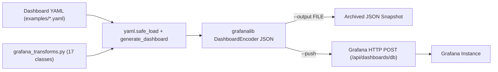

# Grafana Tools

[](https://www.buymeacoffee.com/jmrenouard)

Command-line toolkit to generate, export, and publish Grafana dashboards from declarative YAML configurations using `grafanalib`.

## Architecture Overview



## Documentation Portal (Diátaxis)

Structured documentation lives in [`docs/index.md`](docs/index.md):

- **Tutorials:** [Step-by-step YAML generation, export, and container labs](docs/01-tutorials/index.md)
- **How-To Guides:** [Operational procedures in ASD-STE100 Issue 9](docs/02-how-to-guides/index.md)
- **Reference:** [CLI flags, YAML schema, 17 transformations, and 21 examples](docs/03-reference/index.md)
- **Explanation:** [Architecture, grafanalib pipeline, and HTTP API design](docs/04-explanation/index.md)

## Quick Start

### Python Installation

```bash
pip install -r requirements.txt
python3 grafana_helper.py --version
```

### Generate, Export, and Publish

```bash
# Print generated Grafana JSON payload to stdout
python3 grafana_helper.py --file examples/linux-overview.yaml

# Export JSON snapshot for versioned backups or provisioning review
python3 grafana_helper.py --file examples/linux-overview.yaml --output linux-overview.json

# Publish directly to Grafana (/api/dashboards/db)
export GRAFANA_URL="http://localhost:3000"
export GRAFANA_API_KEY="glsa_your_service_account_token"
python3 grafana_helper.py --file examples/linux-overview.yaml --push
```

### Docker Usage

```bash
docker build -t jmrenouard/grafana-tools:latest .
docker run --rm \
  -v "$(pwd):/work" \
  -e GRAFANA_URL="http://your-grafana-url" \
  -e GRAFANA_API_KEY="your-api-key" \
  jmrenouard/grafana-tools:latest \
  --file /work/examples/linux-overview.yaml --push
```

### Makefile Targets

| Target | Command | Purpose |
| :--- | :--- | :--- |
| `install` | `make install` | Install `grafanalib`, `PyYAML`, and `requests` |
| `lint` | `make lint` | Run `pylint grafana_helper.py` |
| `run` | `make run file=examples/linux-overview.yaml` | Generate dashboard JSON to stdout |
| `build` | `make build` | Build `jmrenouard/grafana-tools:latest` and `:${VERSION}` |
| `push` | `make push` | Build and push Docker images to Docker Hub |
| `clean` | `make clean` | Delete `__pycache__` and `.pyc` files |

## Repository Inventory

- **`grafana_helper.py`** (`1.0.1`): CLI entry point (`--file`, `--output`, `--push`, `--version`) converting YAML definitions into `grafanalib` JSON and publishing via `/api/dashboards/db`.
- **`grafana_transforms.py`**: Transformation builders (`TRANSFORMATIONS_MAP`, `17` Grafana panel transformations including `filterByName`, `merge`, `reduce`, `groupBy`, `organize`).
- **`examples/`**: `21` ready-to-use YAML dashboard configurations across Linux (`4`), MySQL/MariaDB (`3`), PostgreSQL (`3`), Nginx (`3`), Cassandra (`2`), MongoDB (`2`), and application/social metrics (`4`).
- **`Dockerfile` / `Makefile` / `requirements.txt`**: Container packaging (`python:3.9-slim`) and task automation.
- **`tests/`**: Automated verification suite (`tests/test_docs_tutorials_howtos.py`).
