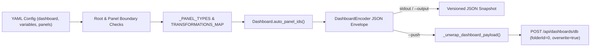
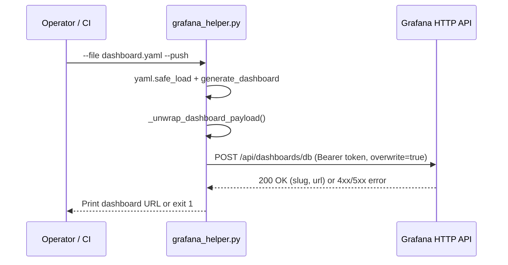

# Architecture, YAML Pipeline, and HTTP API Design

`grafana-tools` acts as a thin declarative compiler between concise domain YAML files (`examples/`) and Grafana's verbose dashboard JSON schema (`grafanalib` + `/api/dashboards/db`).

## Data Flow Architecture

## HTTP Publish Sequence

## Design Decisions and Trade-Offs

### 1. Why YAML + `grafanalib` Instead of Raw JSON

- **Schema abstraction:** Grafana exports often exceed hundreds of JSON lines per dashboard with internal widget defaults (`fieldConfig`, `gridPos`, panel IDs). Declarative YAML narrows authoring to business queries (`expr`), variable definitions, and layout coordinates (`h`, `w`, `x`, `y`).
- **Automated panel numbering:** Calling `.auto_panel_ids()` assigns sequential panel IDs deterministically, eliminating manual ID conflicts during panel additions or removals.
- **Controlled panel surface:** `_PANEL_TYPES` intentionally limits panels to `timeseries`, `stat`, and `gauge` so `create_panel` guarantees compatible `unit`/`format` bindings.

### 2. Why `push_to_grafana` Unwraps `"dashboard"`

- **Envelope mismatch:** Both `--output` and stdout emit Grafana's import wrapper (`{"dashboard": <model>, "overwrite": true}`), which stores metadata alongside the dashboard body.
- **API expectation:** Grafana's `POST /api/dashboards/db` requires `"dashboard"` to hold the dashboard model directly (`title`, `panels`, `templating`), paired with top-level `folderId` and `overwrite`.
- **Single boundary guard:** `_unwrap_dashboard_payload()` handles both wrapped CLI strings and raw dashboard dictionaries so callers never send a double-nested `"dashboard.dashboard"` object.

### 3. Why `overwrite: true` and `folderId: 0` Trade Convenience for Caution

- **Idempotency:** Setting `overwrite: true` allows Git-driven re-runs without duplicate-title `412 Precondition Failed` errors.
- **Operational trade-off:** Any manual edits made directly in the Grafana UI to a dashboard managed by `grafana-tools` are replaced on the next `--push`. Storing YAML sources in Git alongside `--output` snapshots keeps rollbacks reproducible.
