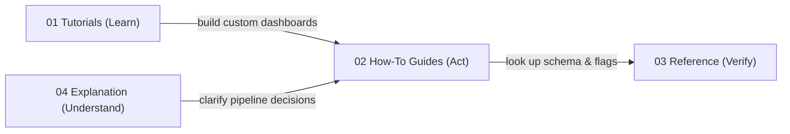

# Grafana Tools Documentation

Documentation for `grafana-tools`, structured with the Diátaxis framework for YAML-to-Grafana dashboard generation, JSON export, container execution, and HTTP API publishing.

## Quadrants

| Quadrant | Focus | Audience | Entry Point |
| :--- | :--- | :--- | :--- |
| **Tutorials** | Guided hands-on workflow | First-time operators | [Tutorials Index](01-tutorials/index.md) |
| **How-To Guides** | ASD-STE100 Issue 9 procedures | Operators publishing & exporting | [How-To Guides Index](02-how-to-guides/index.md) |
| **Reference** | Exact flags, YAML schema & matrices | Dashboard authors & automation | [Reference Index](03-reference/index.md) |
| **Explanation** | Design, API wrapping & trade-offs | Maintainers & architects | [Explanation Index](04-explanation/index.md) |

[Back to Repository Overview](../README.md)
